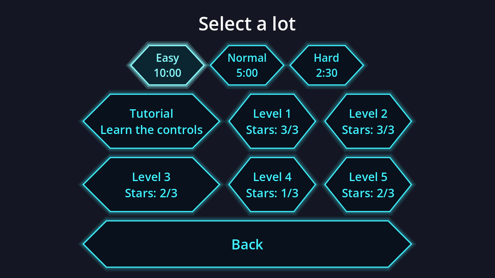
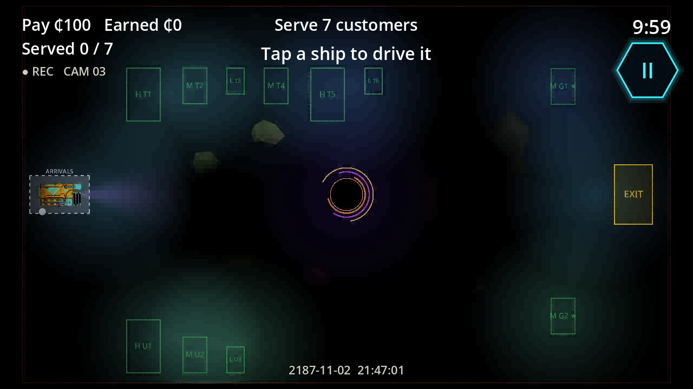

# Parkin' Space – ITSD 85 Lab 5
Team: Ethan Campomanes (solo developer: design, code, art, testing)   Section: BSIT 4C   Platform: Android (landscape)

## About the game
A top-down zero-gravity valet parking game: park and retrieve spaceships of every shape and size in pitch-black space parking lots without denting anything, because damage comes out of your pay. Every ship is a mass pushed by thrusters drawn on its hull, so each one handles differently. Five levels each add one new idea (tips and retrievals, wrecks and radiation, a black hole, a gold-customer rush hour), and a LAN duel lets two phones compete on the same lot. 




More screenshots are in [docs/screenshots/](docs/screenshots/).

## How to play
- **Tutorial:** the first tap on **Play Offline** opens a 12-step practice lot that teaches every control. It can't be failed, and a pulsing ring and arrow show what to tap. You can replay it any time from the first tile on Level Select.
- **Lot view:** tap a ship to take control (if several are under your finger, pick one from the list).
- **Driving:** left pad thrusts forward/back and strafes left/right; hold the centre **STOP** to brake. Right buttons rotate; hold **Stop Spin** to stop turning.
- **Parking:** stop the whole ship inside a space of its class (L / M / H) or larger; the space turns orange; press **Done** to park and get paid.
- **Customers:** arrivals wait in the ARRIVALS bay; retrieval requests must be driven onto the EXIT pad. Tip tiers (bronze/silver/gold) pay extra; gold customers only tip in gold ★ spaces.
- **Pay:** light bumps are free, hard hits dent the ship and cost pay. Pay at zero = fired. While you drive, a thin glow at the screen edges goes from green to yellow (dents start) to red (an expensive crash).
- **Levels:** serve every customer before the shift ends to clear a level and unlock the next one. Stars depend on earnings. Progress is saved on the phone.
- **How to Play** (Mode Select or the pause menu) explains every element with pictures.

## Offline and online modes
- **Offline:** the 5-level solo campaign; works fully in airplane mode. Difficulty sets the shift length (Easy 10:00, Normal 5:00, Hard 2:30).
- **Online (same Wi-Fi, no server):** Mode Select → Online. One phone sets the match length (3–20 min) and taps **Host**; its Wi-Fi IP appears. The other phone types that IP and taps **Join**. The host runs the match and decides the winner. If the host can't be reached, or the rival disconnects, the game shows a message and returns to Mode Select.
  - Hosting from a Windows PC on a "Public" Wi-Fi profile: allow Godot through Windows Firewall.

## How to build
1. Install **Godot 4.7** (standard, not .NET) and open `project.godot`.
2. Editor → Manage Export Templates → Download and Install.
3. Install **OpenJDK 17** and the **Android SDK** command-line tools (see Godot's "Exporting for Android" page), then set both paths in Editor Settings → Export → Android.
4. Project → Export → Android preset (`com.itsd85.ecampomanes.parkinspace`, landscape, permissions Internet and Access Network State) → Export Project → `export/parkin-space.apk`.
5. Install on the phone (copy the APK and allow "Install unknown apps", or `adb install -r export/parkin-space.apk`).

Run the automated tests (headless):
```bash
godot --headless --path . --import
godot --headless --path . res://tests/TestRunner.tscn   # summary line: ALL TESTS PASSED
```

## Download
Latest APK: the **v1.0 release** on this repository's [Releases page](../../releases) (debug-signed; allow "Install unknown apps" when asked).

## Playtest results
Full action plan: [docs/playtest/action-plan.md](docs/playtest/action-plan.md). Kit: [docs/playtest/playtest-kit.md](docs/playtest/playtest-kit.md). Phone test matrix: [docs/playtest/phone-test-matrix.md](docs/playtest/phone-test-matrix.md).

1. **Players got stuck on the controls and skipped the guide.** Fix: a guided 12-step Tutorial that opens on the first Offline tap, plus an ARRIVALS bay that pulses while a ship waits. _Retest: pending._
2. **No warning before hitting a wall.** Fix: a red lot-edge glow when the driven ship nears a wall. _Retest: pending._
3. **Players thought the game was stuck while owners were away.** Fix: return countdowns on parked ships and a HUD "waiting" line. _Retest: pending._

## Credits
See [docs/CREDITS.md](docs/CREDITS.md) (Kenney CC0 art and sound, ccMixter CC BY-NC 3.0 music, Orbitron SIL OFL font; ships and all other art original).

## Paper
[docs/paper.pdf](docs/paper.pdf) (_in progress_). The LaTeX source (IEEE conference template, built on Overleaf) is [docs/paper/paper.tex](docs/paper/paper.tex).
